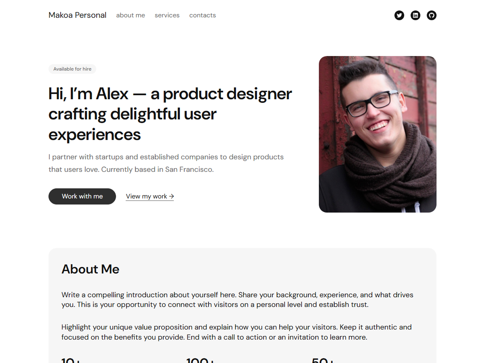

# Makoa Personal

  

A clean and modern personal portfolio theme built for freelancers, designers, developers, and creative professionals. Features a minimal hero section with photo, about me block with statistics, services showcase, blog feed, and contact section. Perfect for building a professional online presence with a focus on simplicity and user experience.

- **WordPress.org:** https://wordpress.org/themes/makoa-personal/
- **Live preview:** https://wp-themes.com/makoa-personal/

## Installation

1. In your WordPress admin, go to Appearance > Themes and click "Add New Theme".
2. Search for "Makoa Personal" and click "Install", then "Activate".
3. Go to Appearance > Editor to customize templates, styles and patterns.

To install the development version from this repository, download it as a ZIP (Code > Download ZIP), rename the folder inside to `makoa-personal` and upload it in Appearance > Themes > Add New Theme > Upload Theme.

## Requirements

- WordPress 6.9 or later
- Tested up to WordPress 7.1
- PHP 7.4 or later

## Changelog and credits

The full changelog, image and font credits with their licenses are listed in [readme.txt](readme.txt).

## License

Makoa Personal is distributed under the terms of the [GNU General Public License v2 or later](https://www.gnu.org/licenses/gpl-2.0.html).

---

More themes by Roman Fink: https://wordpress.org/themes/author/romanfink/
